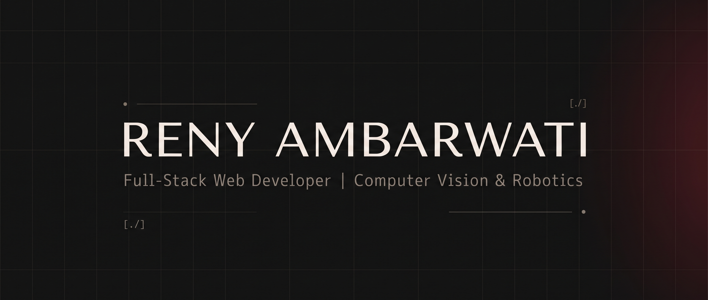

<!-- Header Banner Elegan (Capsule Render) -->

 

<!-- Social & Portfolio Links -->

  
  
  

---

### About Me

I'm a 5th-semester Informatics Engineering student at **Politeknik Negeri Malang**, working at the intersection of **Full-Stack Web Engineering** and **Computer Vision / AI**.

- 💻 **Web & Backend:** Building structured end-to-end web applications, RESTful APIs, relational databases, and automated reporting systems.
- 👁️ **Computer Vision & Robotics:** Developing real-time object detection pipelines, ROS 2 nodes, custom HMI displays, and edge inference optimization as part of the **ABUROBONEMA Robotics Team** (*KRAI 2026 National Finalist*).
- 🔬 **Applied AI Research:** Assisting faculty research on AI-based video analytics early warning systems for command centers.
- 📊 **Data & BI:** Working with ETL pipelines and interactive business intelligence dashboards.

---

### Featured Projects

<table>
  <tr>
    <td width="50%" valign="top">
      <h3>🛒 SkillKul — Freelance Marketplace</h3>
      End-to-end student freelance marketplace featuring multi-role authentication, service catalogs, automated <b>Midtrans</b> payment verification, and dynamic PDF invoicing (<b>DomPDF</b>).
        
      <code>Laravel</code> · <code>Tailwind CSS</code> · <code>PostgreSQL</code> · <code>Midtrans API</code>
        
      <a href="https://github.com/Renyambar/Skillkul_PBL"><b>View Repository →</b></a>
    </td>
    <td width="50%" valign="top">
      <h3>🤖 ABU Robocon (KRAI 2026) Vision</h3>
      Real-time object detection and coordinate estimation for autonomous robots, complete with a custom HMI control interface and edge hardware optimization (INT8 quantization & pruning).
        
      <code>YOLOv8</code> · <code>ROS 2 Humble</code> · <code>TensorRT</code> · <code>OpenVINO</code> · <code>NCNN</code>
        
      <a href="https://github.com/Renyambar/abu-riset"><b>View Repository →</b></a>
    </td>
  </tr>
  <tr>
    <td width="50%" valign="top">
      <h3>🌱 CapSee — AI Mobile Capstone</h3>
      Cross-platform mobile application integrating deep learning image classification and scan workflows for plant health detection.
        
      <code>Python</code> · <code>OpenCV</code> · <code>PyTorch</code> · <code>TensorFlow</code> · <code>Flutter</code>
        
      <a href="https://github.com/Adhityayusuf/capsee"><b>View Repository →</b></a>
    </td>
    <td width="50%" valign="top">
      <h3>🏛️ Lab Mobile & Multimedia CMS</h3>
      Official profile portal and Content Management System (CMS) for managing laboratory facilities, research publications, and schedules at Polinema.
        
      <code>Laravel</code> · <code>Blade</code> · <code>Tailwind CSS</code> · <code>PostgreSQL</code>
        
      <a href="https://github.com/Renyambar/PBL_LabMMT"><b>View Repository →</b></a>
    </td>
  </tr>
</table>

---

### Technical Stack

#### 🌐 Web & Mobile Development

#### 🧠 AI, Computer Vision & Edge Robotics

#### 🗄️ Databases, BI & DevOps

---

### GitHub Activity

  
  

  

---

  Explore more projects and case studies at <a href="https://minipaoo.web.id"><b>minipaoo.web.id</b></a>

